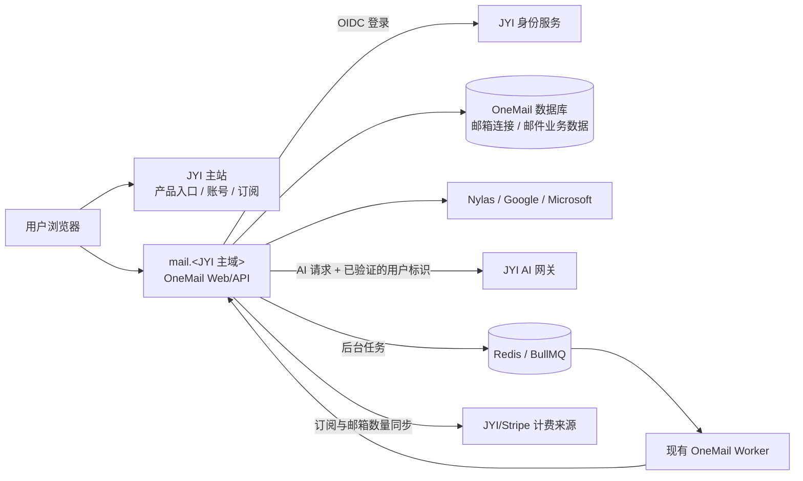

# JYI × OneMail 集成方案

> **2026-10-25 更新：产品方向已回到 hosted Web，本方案的 JYI 集成边界重新适用。** 当前部署形态是 Cloudflare Workers 上的独立 OneMail Worker，具体资源与回调见 [Cloudflare Workers 部署](../hosting/cloudflare-workers.mdx)。本地 Tauri 客户端保留为可选实验，不再是主线。本文的订阅、Nylas 计费和账号映射规则仍需按当前商业规则重新确认。

**状态：方案稿，尚未完成生产接入或上线验收。** 本文用于确定系统边界、交付顺序和验收条件；未把待确认事项描述为已完成，也不代表授权发布、收费或修改 JYI 生产配置。

## 1. 结论与目标

OneMail 作为 JYI 产品体系内的邮件工作区，通过独立子域名交付，例如 `mail.<JYI 主域>`。JYI 主站负责产品入口、身份、订阅与 AI 用量入口；OneMail 保留自己的 Web/API、邮箱数据和邮件业务逻辑。长任务继续由现有后台 worker 处理。

目标用户体验：从 JYI 进入邮件工作区时，通过 JYI OAuth 登录；用户在 OneMail 连接邮箱、使用分析和邮件功能；账号、订阅和 AI 用量归属 JYI，邮箱授权与邮件功能数据由 OneMail 管理。

### 项目记录

| 项目项 | 当前记录 |
| --- | --- |
| 产品形态 | 带账号、邮箱连接、订阅和 AI 能力的 Web 应用 |
| 产品入口 | JYI 导航/产品页 → OneMail 子域名；具体 URL 待确认 |
| 基线代码 | `main`，登录统一改造提交 `00f822151` |
| 核心任务 | JYI 登录；连接 Google/Microsoft 邮箱；使用邮件助手；管理订阅与邮箱连接 |
| 已确认商业规则 | Google 邮箱 $4.99 CAD/邮箱/月；计费数量按已连接 Google 邮箱数计算；无订阅不可连接 Google 邮箱；取消订阅到期后移除 Nylas grant，并要求邮箱重新连接；已断开邮箱不继续计费 |
| AI 归属 | 助手向所有账号开放；AI 请求经 JYI 网关，并按已验证的 JYI 用户标识记账 |
| 登录规则 | 所有部署统一使用 JYI 身份；JYI 标准为密码登录和邮箱验证链接，停用 OneMail 邮箱验证码登录 |
| 目标地区/法律适用性 | 待业务/法律负责人确认；CAD 定价本身不足以确定全部适用地区 |
| 负责人/时间 | 产品、工程、运维、隐私/法律负责人及日期待指定 |

## 2. 目标架构与责任边界

### JYI 负责

- 身份、密码和邮箱验证链接；OIDC issuer、稳定用户 subject、OAuth 客户端与回调白名单。
- 订阅状态、价格/数量的权威来源，以及续费、取消、支付失败的生命周期事件。
- AI 网关、模型访问策略和按用户统计的用量数据。
- JYI 主站中的 OneMail 产品入口、品牌导航与统一产品说明。
- 若 OneMail 需要发送非登录类邮件，提供现有 JYI Worker 的发送接口和鉴权契约。

### OneMail 负责

- 邮箱授权、Nylas grant、邮件同步、邮件规则、摘要/分类等业务逻辑和结果。
- OneMail 自有数据库中的邮箱与业务数据；按稳定 JYI 用户 ID 归属，不以浏览器提交的用户 ID 授权。
- Next.js Web/API 与已存在的 BullMQ 后台 worker。
- Google 邮箱连接权限、邮箱断开/删除和业务状态同步。

### 部署边界

- 前台：保留 OneMail 独立 Web 应用，部署到 JYI 子域名；JYI 主站提供链接和统一品牌入口。使用 OAuth 完成 SSO，不共享跨子域 Cookie，不采用 iframe。
- 后台任务：继续部署现有 `apps/worker` BullMQ 进程，连接 Redis 并通过受鉴权的内部 API 执行任务。这里的 worker 是后台进程，不是 Cloudflare Worker。
- 不为本次集成新增 Durable Objects。AI 分析和邮件批处理走队列、数据库任务状态及现有 worker；若以后确有长连接协作或跨实例实时协调需求，再单独评估。
- 初期不要求把 OneMail 全量搬进 JYI 主站仓库或改成 `/<path>` 部署。待域名、运维和用户规模验证后再决定是否合并部署。

## 3. 关键流程设计

### 3.1 登录与账户映射

1. 用户从 JYI 导航进入 `mail.<JYI 主域>`。
2. 未登录或 OneMail 会话失效时，跳转至 JYI OIDC 登录，并携带受校验的回跳地址。
3. 登录成功后，OneMail 仅依据已验证的 issuer、subject 和必要的邮箱验证声明建立本地会话。
4. JYI 用户 ID 与 OneMail 本地用户/邮箱数据建立唯一映射；前端不可指定或覆盖该归属。
5. 退出时清除 OneMail 本地会话，并按 JYI 支持的协议退出身份会话；多标签页和过期会话要有清晰反馈。

**验收重点：** 首次登录、已有用户映射、已验证邮箱的旧账号绑定、同邮箱不同 subject、禁用用户、错误 issuer/audience、过期令牌、恶意回跳地址和退出。旧账号迁移策略须避免重复账号和越权绑定。

### 3.2 Google 邮箱计费

- 连接 Google 前，服务端查询 JYI 权威订阅状态；无有效订阅时拒绝创建 Nylas grant。
- 计费数量以符合计费规则的活跃 Google mailbox/grant 数计算，不接受客户端数量。
- 断开邮箱后，grant 撤销/删除与计费数量更新应可重试且幂等；断开的邮箱不再计费。
- 取消订阅按已确认规则持续到期；到期后移除 Nylas grant，将邮箱标记为需要重新连接。清理失败必须可观测并有重试/人工修复路径。
- 明确新增/断开邮箱的 Stripe 数量变更和 proration 规则、支付失败后的可用窗口、退款边界；这些细节尚未由本方案擅自决定。

### 3.3 AI 分析与用量

- 服务端从已验证的 JYI 会话取得 user ID 和邮箱，并在发给 JYI 网关时设置 `x-jyi-user-id` 与 `x-jyi-user-email`；转发前覆盖任何浏览器传入的同名头。
- AI 流量仅发送到已批准的 JYI 网关目标；网关凭据仅保存在服务端。
- 对话、摘要和后台分析继续由 OneMail 现有流程触发；耗时任务入队，结果/状态写入 OneMail 数据库。
- 记录足以对账的请求 ID、JYI 用户 ID、模型/用量、结果状态和时间；避免在普通日志中记录邮件正文、收件人等邮件 PII。
- 网关鉴权失败、超时、限额和用户身份缺失均应返回明确错误或可重试状态，不回退到个人模型 API key。

### 3.4 邮箱连接、Webhook 与邮件通知

- Google 通过 Nylas，Microsoft 使用已配置的 Microsoft OAuth 路径；生产 OAuth 同意屏幕、回调地址和应用发布状态需实际核验。
- Webhook 验签、重放保护、租户/邮箱归属检查和失败重试应在 OneMail 服务边界完成。
- 登录验证链接由 JYI 身份系统发送。OneMail 不恢复六位验证码登录，也不为此引入 Resend。
- 其他产品邮件按 JYI 约定接入现有 Worker；其 URL、请求体、服务鉴权、限流、模板所有权和送达事件需从 JYI 项目确认。未拿到契约前不假定邮件发送已集成。

## 4. 配置与外部依赖清单

所有值通过目标环境的密钥管理配置；本计划和仓库文档不存放密钥本身。

| 依赖 | 需要确认/配置 | 验收证据 |
| --- | --- | --- |
| 域名与 TLS | JYI 主域、OneMail 子域、DNS、证书、生产/预览域名 | HTTPS 可访问、证书有效、回调域名匹配 |
| JYI OIDC | discovery URL、client ID/secret、scope、授权回调和退出行为 | issuer/audience/subject 验证成功，错误声明被拒绝 |
| 邮箱服务 | Nylas API key/client ID/webhook secret/API region；Google 与 Microsoft OAuth 客户端和同意屏幕 | 沙箱/测试用户可授权、同步、断开，Webhook 签名校验通过 |
| 订阅 | CAD 499/单位/月 recurring Stripe Price ID；订阅查询、变更、取消及支付事件的 JYI 权威接口/契约 | 沙箱中订阅数量、金额、到期和断开后的状态可对账 |
| AI 网关 | JYI gateway base URL、服务端密钥、用户身份头契约、可用模型和限额 | 网关日志能按 JYI 用户归属用量；无凭据/无身份请求被拒绝 |
| 队列与数据库 | OneMail 数据库连接；Redis/BullMQ 或已批准队列后端；worker 内部 API URL/key | Worker 消费、失败重试、幂等处理和告警可验证 |
| JYI 邮件 Worker | 若 OneMail 有非登录类发信，提供 endpoint、鉴权、payload、模板及回执契约 | 测试邮件发送、失败行为、限流和日志脱敏可验证 |
| 观测/恢复 | 错误与队列监控、Webhook/计费对账告警、数据库备份、恢复和回滚责任人 | 生产演练记录、告警接收人和恢复证据 |

现有配置入口已包含 JYI OIDC、Nylas、Stripe price、AI gateway 和 Redis/BullMQ 相关 env 定义（`apps/web/.env.example`、`apps/web/env.ts`、`turbo.json`）。这只说明代码有配置入口，不代表目标环境已经配好或生产链路已通过。

## 5. 交付阶段与出口条件

| 阶段 | 工作包 | 出口条件 |
| --- | --- | --- |
| I0 产品与服务边界 | 确认 OneMail 产品名称、子域、支持地区、JYI/OneMail 数据所有者、账号迁移规则及责任人 | 域名、账号主键和数据责任均有明确结论；未确定的法律适用地区有负责人 |
| I1 JYI 接入契约 | 获取 OIDC、订阅/Stripe、AI 网关、邮件 Worker（如适用）接口契约及沙箱凭据 | staging 所需接口、回调白名单、事件与错误语义确定 |
| I2 SSO 端到端 | 配置子域名、TLS、JYI 登录、会话、退出和账号映射 | 新用户、存量绑定、错误身份和回跳安全路径通过 staging 验收 |
| I3 邮箱生命周期 | 验证 Nylas Google 与 Microsoft 连接、Webhook、断开和取消订阅后的 grant 清理 | Google 收费门禁与邮箱状态/数量能互相对账；失败可重试 |
| I4 AI 网关与任务 | 所有助手调用切到 JYI 网关；验证身份头来源、限额、用量对账及后台分析队列 | 不可伪造用户归属；任务重试不产生重复账单或重复副作用 |
| I5 产品体验统一 | JYI 导航入口、品牌、定价与功能说明、错误/空/加载状态、移动端关键路径 | 用户知道正在进入 JYI 邮件产品；价格/取消规则和实现一致 |
| I6 staging 联测 | OAuth、邮箱、Stripe sandbox、AI 网关、Webhook、邮件 Worker、队列全链路联测 | 关键用例有版本、环境、步骤、结果和证据；P0/P1 阻塞清零 |
| I7 生产发布 | 配置密钥、DNS/TLS、回调、备份、监控、回滚和客服交接 | 发布责任人确认；生产冒烟通过；生产故障有告警与回滚路径 |
| I8 稳定期 | 观察登录成功率、邮箱连接/同步、计费对账、AI 用量、队列延迟与支持工单 | 约定稳定期指标达标，遗留问题有负责人和期限 |

## 6. 验收矩阵

所有条目初始状态为**未开始**。正式联测时按候选版本、环境和配置记录实际结果；没有证据不得标记通过。

| ID | 场景 | 通过标准 | 状态 |
| --- | --- | --- | --- |
| AUTH-01 | 从 JYI 主站进入 OneMail | 正确完成 SSO，并返回用户原请求的允许路径 | 未开始 |
| AUTH-02 | 账户映射与账号绑定 | 不因未验证邮箱、不同 issuer/subject 或恶意请求绑定他人数据 | 未开始 |
| AUTH-03 | 会话退出/过期 | 受保护数据拒绝访问；用户收到可操作的重新登录提示 | 未开始 |
| BILL-01 | 无订阅连接 Google | 服务端拒绝创建 grant，UI 说明当前可采取的操作 | 未开始 |
| BILL-02 | 增减 Google 邮箱 | 服务端计算数量并与订阅数量一致；重复 webhook 安全 | 未开始 |
| BILL-03 | 到期取消 | 到期清除 grant、标记重新连接；已断开邮箱不计费 | 未开始 |
| BILL-04 | 支付失败/服务中断 | 按确定的宽限与恢复规则处理，不误删或继续错误计费 | 未开始 |
| AI-01 | 用户发起助手/分析 | 网关收到已认证的 JYI 用户 ID；客户端伪造头不能改变归属 | 未开始 |
| AI-02 | 网关失败/限额/超时 | 显示可理解的失败状态；按策略重试，不静默切到其他供应商 | 未开始 |
| AI-03 | 后台分析重试 | 任务可重试、可观测且不会重复产生不可逆副作用 | 未开始 |
| MAIL-01 | Nylas/Microsoft 授权和同步 | 授权范围、用户提示、数据同步和撤销符合批准配置 | 未开始 |
| MAIL-02 | Webhook | 未签名、错误归属、重放请求被拒绝或幂等处理 | 未开始 |
| OPS-01 | 队列/Redis/API 故障 | 用户可见任务状态一致；恢复后任务能重试或明确失败 | 未开始 |
| PRIV-01 | AI 与日志数据边界 | AI 请求接收方、保留和日志字段已盘点；邮件正文不进入普通日志 | 未开始 |
| UX-01 | 桌面/移动端主流程 | 登录、连接邮箱、看分析、管理邮箱/计费均可操作 | 未开始 |
| REL-01 | 生产回滚/恢复 | 可回到前一候选版本；数据/授权清理不会因回滚变成未跟踪状态 | 未开始 |

## 7. 风险与待决事项

1. **JYI 身份和 OneMail 本地用户不一致：** 在 staging 验证稳定 subject 映射、存量账户绑定和重复账号处理，不以展示邮箱作为唯一安全主键。
2. **计费双向漂移：** 为 Stripe 数量变化和 Nylas grant 建立幂等对账；定义 proration、取消宽限期、支付失败和 provider 断开时的商业规则。
3. **JYI 服务契约未齐：** OIDC、订阅查询/事件、AI 网关身份头和邮件 Worker 契约都需要服务所有者提供并版本化。
4. **邮箱内容敏感：** 盘点邮件正文、附件、摘要发送到 Nylas、模型网关及其他供应商的路径、处理地区和保留策略；由负责人确认适用的隐私告知和供应商条款。
5. **子域 SSO 误解：** OAuth 会建立 OneMail 自己的会话；不依赖共享 Cookie。需验证登录回调、退出和会话撤销行为。
6. **生产 OAuth 审核：** Google/Microsoft consent screen、域名验证、回调和应用发布状态必须用生产 JYI/OneMail 域核验。
7. **服务可用性与恢复：** 邮件同步、AI 网关和 Redis 故障需有重试上限、死信/人工修复入口、告警、备份恢复和责任人。

### 发布前必须确认

- JYI 主域及正式 OneMail 子域；staging 与 production 域名。
- OIDC issuer/discovery、客户端、回调与退出规范，以及存量用户映射方式。
- JYI 订阅权威接口、Stripe Price ID、数量同步语义、proration 和取消/支付失败规则。
- AI 网关 URL、用户身份头约定、限额、模型允许列表、网关故障行为和用量对账方式。
- Nylas、Google、Microsoft 生产凭据及回调/审核状态。
- JYI 邮件 Worker 的调用契约（如果需要 OneMail 发送非登录类邮件）。
- 业务运营主体、目标地区、隐私/数据保留策略，以及产品/工程/运维/隐私责任人。
- DNS/TLS、生产密钥管理、监控告警、数据库备份/恢复、回滚触发条件和稳定期指标。

## 8. 不在本期范围

- 新建独立原生桌面/移动产品线；当前计划交付 JYI 子域上的 Web 工作区。
- 把 OneMail 所有数据库/邮件业务迁移到 JYI 主站数据库；先保持明确的数据所有权边界。
- 用 iframe 嵌入 JYI、按路径反向代理、迁移到 Cloudflare Workers/DO。
- 重写邮件队列或为 AI 分析新建 Durable Objects。
- 未经单独业务确认改变 CAD 定价、取消/退款、AI 使用限额或邮箱授权范围。

## 9. 交接产物

- JYI ↔ OneMail 接口契约：OIDC、订阅事件/查询、AI 网关身份与用量、邮件 Worker（适用时）。
- 按环境的密钥/回调配置表（不含密钥值）、域名/DNS/TLS 清单。
- 生产数据流和供应商清单、账号映射/迁移说明、Webhook 及队列恢复手册。
- staging 与 production 验收记录、发布版本、回滚步骤、告警接收人、稳定期指标和遗留项负责人。

